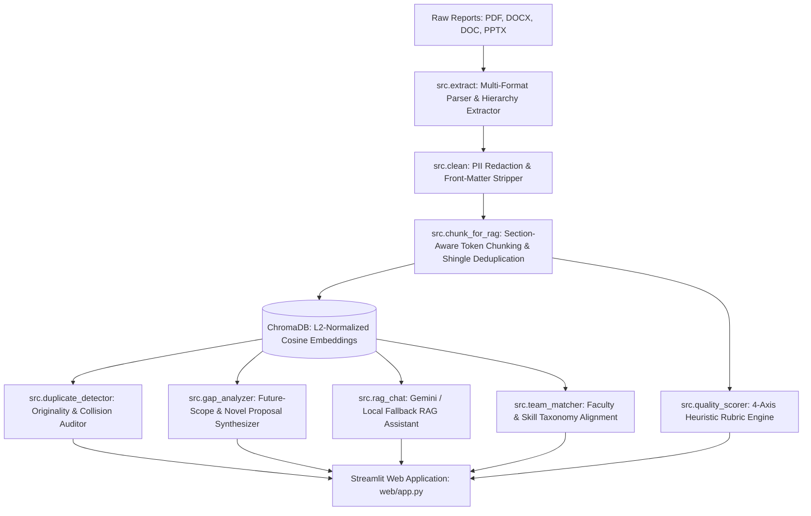

# Project-IQ: Academic Intelligence & Structure-Aware RAG Platform

[](https://www.python.org/)
[](https://streamlit.io/)
[](https://www.trychroma.com/)
[](https://ai.google.dev/)
[]()
[](LICENSE)

**Project-IQ** is an institutional academic intelligence platform engineered to mine multi-department archives of final-year engineering capstones, black book project reports, seminar documents, and review presentations (`.pdf`, `.docx`, `.doc`, `.pptx`). 

It provides automated plagiarism & originality auditing, limitation/gap synthesis, rule-based rubric quality scoring, mentor matching, and section-grounded Retrieval-Augmented Generation (RAG) with local offline fallbacks.

---

## Table of Contents

- [Key Capabilities](#key-capabilities)
- [System Architecture](#system-architecture)
- [Project Directory Structure](#project-directory-structure)
- [Quick Start](#quick-start)
  - [Windows (One-Click Setup)](#windows-one-click-setup)
  - [Linux & macOS](#linux--macos)
  - [Docker & Containerized Deployment](#docker--containerized-deployment)
- [Environment Configuration](#environment-configuration)
- [Pipeline Execution](#pipeline-execution)
- [Modules Overview](#modules-overview)
- [Web Dashboard Guide](#web-dashboard-guide)
- [Testing & Quality Assurance](#testing--quality-assurance)
- [Privacy, Compliance & Redaction](#privacy-compliance--redaction)
- [Troubleshooting & Diagnostics](#troubleshooting--diagnostics)
- [Contributing & License](#contributing--license)

---

## Key Capabilities

1. **Originality & Duplicate Detection**
   - Computes embedding cosine similarity against the entire corpus of past institutional projects.
   - Categorizes project proposals into **High Similarity (Plagiarism / Duplicate Alert)**, **Moderate Overlap**, or **Novel Proposal**.
   - Highlights matching projects, shared technical concepts, and provides actionable recommendations.

2. **Research Gap & Novelty Synthesis**
   - Automatically parses methodology limitations, hardware/latency bottlenecks, and future scope passages from past reports.
   - Leverages Google Gemini (with resilient dynamic fallback to local rule-based synthesis when offline) to propose feasible, novel final-year projects with difficulty and impact estimates.

3. **Rubric-Based Quality Scorer**
   - A transparent, reproducible 100-point heuristic scoring system across 4 dimensions:
     - **Methodology Depth** (steps, pipeline flow, reproducibility)
     - **Metric Rigor** (empirical benchmarks, accuracy, F1, latency, throughput)
     - **Tech Stack Coherence** (compatibility and relevance of declared frameworks)
     - **Problem Clarity** (objective formulation and scope definition)
   - Eliminates opaque black-box LLM scoring in favor of verifiable academic rubrics.

4. **Structure-Aware RAG Academic Assistant**
   - Conversational search grounded directly in institutional project chunks.
   - Every answer cites exact document names, academic departments, project groups, and section titles.
   - Built-in guardrails detect off-topic or out-of-domain inquiries.

5. **Cross-Disciplinary Team & Faculty Matcher**
   - Analyzes student skill profiles and proposed ideas against a categorized engineering taxonomy (Computer Vision, NLP, Edge Computing, Healthcare AI, Distributed Systems, Cybersecurity, etc.).
   - Recommends faculty advisors, domain mentors, and complementary team roles.

6. **Secured Administrative Portal**
   - Passkey-protected admin interface for running live pipeline re-indexing, viewing raw audit logs, updating originality thresholds, and inspecting corpus statistics.

---

## System Architecture



### Ingestion Pipeline Highlights
- **College Hierarchy Extraction**: Automatically infers department (`DS_1`, `CS_2`, etc.), group ID (`Group 4`), and report category (`Black Book`, `Review 4`, etc.) from the folder structure.
- **OCR & Format Fallbacks**: Scanned PDFs are seamlessly processed via Tesseract OCR; legacy binary `.doc` files are converted through LibreOffice headless mode.
- **Section-Aware Chunking**: Maintains semantic boundaries up to 520 tokens with 80-token overlap; shingles identify near-duplicate text blocks while preserving full context.
- **Idempotent Vector Indexing**: Deterministic MD5 chunk IDs prevent duplicate indexing on repeated pipeline runs; stale records are automatically pruned.

---

## Project Directory Structure

```text
PROJECT-IQV2/
├── .streamlit/
│   └── config.toml             # Streamlit UI theme and server configuration
├── data/
│   ├── raw/                    # Raw student submissions: <DEPT>/<Group N>/... (.gitkeep)
│   ├── extracted/              # Extracted JSON texts with structural metadata (.gitkeep)
│   ├── cleaned/                # PII-redacted, front-matter-cleaned texts (.gitkeep)
│   ├── chunks/
│   │   └── chunks.jsonl        # Section-aware tokenized chunks ready for vector indexing
│   ├── chroma_db/              # ChromaDB vector database (git-ignored)
│   └── reports/
│       ├── cleaning_report.json
│       ├── novel_project_proposals.json
│       └── pipeline_summary.json
├── logs/                       # Rotating application logs (git-ignored)
├── scripts/
│   └── doctor.py               # Pre-flight environment & dependency diagnostic tool
├── src/
│   ├── __init__.py             # Module namespace
│   ├── chunk_for_rag.py        # Token-bounded chunker with shingle near-dup detection
│   ├── clean.py                # spaCy NER + regex PII redaction and front-matter filter
│   ├── config.py               # Centralized config (PROJECTIQ_ and PROJECT_IQ_ env prefixes)
│   ├── duplicate_detector.py   # Embedding cosine similarity originality engine
│   ├── embeddings.py           # Shared thread-safe SentenceTransformer embedding cache
│   ├── extract.py              # Multi-format document parser (PDF/DOCX/PPTX/DOC)
│   ├── gap_analyzer.py         # Limitation miner & Gemini/local proposal generator
│   ├── llm.py                  # Resilient Gemini client with model fallback & timeout handling
│   ├── logger.py               # Structured color/file logging utility
│   ├── quality_scorer.py       # Deterministic 4-axis rubric quality scoring engine
│   ├── rag_chat.py             # Context-grounded RAG query handler with guardrails
│   ├── team_matcher.py         # Domain taxonomy & faculty mentor recommender
│   └── vector_store.py         # ChromaDB persistence, cosine search, and pruning wrapper
├── tests/
│   ├── conftest.py             # Pytest fixtures and lightweight offline embedding/token fakes
│   ├── test_e2e_offline.py     # Complete offline end-to-end pipeline test
│   └── test_regressions.py     # Regression suite for edge cases, PII, and rubric scoring
├── web/
│   └── app.py                  # Modern conference-grade Streamlit interactive dashboard
├── .dockerignore
├── .env.example                # Template for environment variables and API keys
├── .gitignore                  # Git ignore rules for PII, models, and virtual environments
├── docker-compose.yml          # Containerized multi-service orchestration
├── Dockerfile                  # Production container definition
├── pyproject.toml              # Build specifications and package metadata
├── README.md                   # Project documentation
├── requirements.txt            # Core production dependencies
├── requirements-dev.txt        # Development and testing dependencies
├── run_all.bat                 # Windows automated pipeline runner + web launcher
├── run_pipeline.py             # CLI pipeline orchestrator with stage-selection flags
└── setup_windows.bat           # One-click Windows virtualenv and dependency installer
```

---

## Quick Start

### Windows (One-Click Setup)

1. **Initialize the Environment:**
   ```cmd
   setup_windows.bat
   ```
   *This creates a `.venv`, upgrades pip, installs `requirements.txt` and `requirements-dev.txt`, downloads the `en_core_web_sm` spaCy model, and creates `.env` from `.env.example`.*

2. **Configure Credentials:**
   Open `.env` in any text editor and configure:
   ```dotenv
   PROJECTIQ_ADMIN_PASSKEY=YourSecurePasskey
   GEMINI_API_KEY=AIzaSy...   # Optional (offline local fallback enabled if omitted)
   ```

3. **Add Past Project Documents:**
   Place institutional reports into `data\raw\<DEPARTMENT>\<Group ID>\` (e.g., `data\raw\DS_1\Group 4\blackbook.pdf`).

4. **Execute Pipeline & Launch Dashboard:**
   ```cmd
   run_all.bat
   ```
   *The interactive dashboard will automatically open at `http://localhost:8501`.*

---

### Linux & macOS

1. **Create and activate a virtual environment:**
   ```bash
   python3 -m venv .venv
   source .venv/bin/activate
   ```

2. **Install dependencies and spaCy language model:**
   ```bash
   pip install --upgrade pip
   pip install -r requirements.txt -r requirements-dev.txt
   python -m spacy download en_core_web_sm
   ```

3. **Configure Environment:**
   ```bash
   cp .env.example .env
   # Edit .env with your passkey and Gemini API key
   ```

4. **Run Diagnostics & Pipeline:**
   ```bash
   python scripts/doctor.py
   python run_pipeline.py
   ```

5. **Start Streamlit Dashboard:**
   ```bash
   streamlit run web/app.py
   ```

---

### Docker & Containerized Deployment

1. **Build and start the container:**
   ```bash
   docker compose up --build -d
   ```

2. **Run the pipeline inside the container:**
   ```bash
   docker compose run --rm project-iq python run_pipeline.py
   ```

3. Access the dashboard at `http://localhost:8501`.

---

## Environment Configuration

Configuration values can be set via `.env` or system environment variables. The platform supports the canonical `PROJECTIQ_` prefix as well as the legacy `PROJECT_IQ_` prefix.

| Variable | Default | Description |
|---|---|---|
| `GEMINI_API_KEY` | *(None)* | Google Gemini API key. If omitted, the platform operates in local rule-based synthesis mode. |
| `PROJECTIQ_ADMIN_PASSKEY` | *(None)* | Passkey required to unlock the Admin Portal in the dashboard. If unset, portal is locked. |
| `PROJECTIQ_EMBEDDING_MODEL` | `all-MiniLM-L6-v2` | SentenceTransformer model used for vector embeddings. |
| `PROJECTIQ_LLM_MODEL` | `gemini-flash-latest` | Preferred Gemini model. Automatically falls back to available Flash models if unavailable. |
| `PROJECTIQ_LOG_LEVEL` | `INFO` | Console and file logging verbosity (`DEBUG`, `INFO`, `WARNING`, `ERROR`). |
| `PROJECTIQ_CHUNK_SIZE` | `450` | Target token size per chunk for RAG indexing. |
| `PROJECTIQ_CHUNK_OVERLAP` | `80` | Overlapping token window between adjacent chunks. |
| `PROJECTIQ_HARD_MAX_TOKENS` | `520` | Strict token ceiling per chunk to fit within embedding model context limits. |
| `PROJECTIQ_DUPLICATE_THRESHOLD` | `0.82` | Cosine similarity threshold for flagging a project as a duplicate idea. |
| `PROJECTIQ_MODERATE_THRESHOLD` | `0.65` | Cosine similarity threshold for flagging moderate conceptual overlap. |
| `PROJECTIQ_MIN_RELEVANCE` | `0.20` | Minimum cosine relevance score required for RAG document retrieval. |
| `STREAMLIT_SERVER_PORT` | `8501` | Port on which the Streamlit web dashboard serves traffic. |

---

## Pipeline Execution

The CLI entrypoint `run_pipeline.py` orchestrates the extraction, cleaning, chunking, indexing, and proposal generation stages:

```bash
python run_pipeline.py [OPTIONS]
```

### CLI Flags & Options

- `--reset` : Clears existing extracted files, cleaned data, chunks, and the ChromaDB vector database before running. Prompts for confirmation (`RESET`) to prevent accidental data loss.
- `--skip-extract` : Skips the document extraction stage (useful when re-chunking or re-indexing already extracted text).
- `--skip-clean` : Skips the PII cleaning and front-matter redaction stage.
- `--skip-chunks` : Skips the chunking stage.
- `--skip-index` : Skips indexing chunks into the ChromaDB vector store.
- `--skip-gaps` : Skips generating novel proposals from future-scope sections.

---

## Modules Overview

### 1. Document Extraction (`src/extract.py`)
- Standardizes diverse file formats (`.pdf`, `.docx`, `.doc`, `.pptx`) into clean structural JSON files.
- Extracts document headings, section titles, page numbers, and parses department hierarchy (`data/raw/<Dept>/<Group>/...`).
- Handles OCR for image-only scans using Tesseract.

### 2. PII Redaction & Cleaning (`src/clean.py`)
- Automatically redacts student names using spaCy Named Entity Recognition combined with capitalization heuristics.
- Redacts contact numbers, roll/registration numbers, and email addresses.
- Strips administrative front-matter (College certificates, acknowledgments, Bonafide certificates, table of contents).

### 3. Section-Aware Chunking (`src/chunk_for_rag.py`)
- Tokenizes cleaned text into discrete units bounded between 20 and 520 tokens.
- Generates 6-gram shingles to calculate Jaccard similarities, tagging near-duplicate passages without dropping valuable context.

### 4. Vector Store & Embeddings (`src/vector_store.py` & `src/embeddings.py`)
- Utilizes ChromaDB with L2-normalized vectors (`all-MiniLM-L6-v2`) where dot product equals cosine similarity.
- Thread-safe model caching and deterministic MD5 hashing ensure reproducible vector indexing.

### 5. Originality & Duplicate Detection (`src/duplicate_detector.py`)
- Evaluates candidate project abstracts or titles against all indexed projects.
- Computes top-K matching projects, similarity percentiles, and provides detailed risk classifications.

### 6. Gap Analyzer & Novelty Engine (`src/gap_analyzer.py`)
- Scans chunks for limitation keywords (*"latency"*, *"dataset size"*, *"computational cost"*, *"future work"*).
- Uses Google Gemini or an offline template generator to produce actionable project proposals with feasibility scores (3-10).

### 7. RAG Conversational Engine (`src/rag_chat.py`)
- Retrieves top matching chunks, filters out low-relevance matches, and constructs an evidence-grounded prompt.
- Includes domain guardrails that prevent non-academic or out-of-scope queries from generating hallucinated responses.

### 8. Quality Scorer (`src/quality_scorer.py`)
- Deterministic heuristic evaluation producing scores across Methodology Depth, Metric Rigor, Tech Stack Coherence, and Problem Clarity.
- Penalizes metric keyword stuffing and awards bonus points for empirical benchmark reporting.

---

## Web Dashboard Guide

The web interface is built with Streamlit and organized into six dedicated workspaces:

1. **Originality Auditor**: Paste a prospective project title, problem statement, or abstract to inspect cosine similarity against past years, view matching projects, and obtain duplicate risk verdicts.
2. **RAG Academic Assistant**: Chat with past projects to ask questions like *"What architectures were used for medical imaging in 2024?"* with explicit citations and section quotes.
3. **Research Gap & Novel Proposals**: Explore extracted institutional project limitations and browse AI-synthesized novel project ideas filtered by academic domain.
4. **Quality Scorecard**: Paste or upload project drafts to receive an instant rubric score breakdown with actionable suggestions for academic improvement.
5. **Team & Faculty Matcher**: Input student technical skills and target domains to find the best faculty advisors and complementary peer roles.
6. **Admin Portal**: Enter the admin passkey to inspect database metrics, trigger pipeline updates, view logs, and adjust similarity thresholds dynamically.

---

## Testing & Quality Assurance

Project-IQ includes a comprehensive offline testing suite that runs entirely without requiring live external API connections or heavy ML model downloads:

```bash
pytest
```

### Test Suite Structure
- `tests/conftest.py`: Implements deterministic MD5-based fake vector embeddings and tokenizers for fast, lightweight testing.
- `tests/test_e2e_offline.py`: Validates the end-to-end lifecycle: DOCX generation -> extraction -> PII cleaning -> chunking -> vector indexing -> originality detection -> gap analysis -> RAG chat.
- `tests/test_regressions.py`: Verifies edge cases including hierarchy parsing, PII redactions, decimal series protection, metric-stuffing defenses, and environment variable fallbacks.

All 13 test suites pass reliably and execute in seconds.

---

## Privacy, Compliance & Redaction

Institutional final-year projects often contain sensitive student and faculty information. Project-IQ is built from the ground up to uphold student privacy:

- **Automatic Name Redaction**: Removes detected personal names from document bodies and metadata.
- **Credential & Contact Redaction**: Strips roll numbers, phone numbers, and email addresses.
- **Git Security**: `.gitignore` strictly excludes all raw documents (`data/raw/*`), extracted text (`data/extracted/*`), cleaned text (`data/cleaned/*`), ChromaDB binaries (`data/chroma_db/*`), and local environment secrets (`.env`).
- **Offline Safe**: Operates completely on-premises when Gemini API keys are omitted, ensuring zero institutional text is sent to third-party services.

---

## Troubleshooting & Diagnostics

Run the bundled diagnostic script at any time to verify system requirements:

```bash
python scripts/doctor.py
```

### Common Issues & Resolutions

- **`spaCy model en_core_web_sm missing`**:
  ```bash
  python -m spacy download en_core_web_sm
  ```
- **`fitz / PyMuPDF deprecation warning`**:
  Normal and non-breaking; PyMuPDF is functional across all supported Python versions.
- **`LibreOffice missing (optional)`**:
  Only needed if your archive includes legacy binary `.doc` files (pre-2007 Word). Convert them to `.docx` or install LibreOffice and ensure `soffice` is on your PATH.
- **`Tesseract OCR missing (optional)`**:
  Only required if your documents contain scanned image-only PDFs. Install Tesseract OCR and add it to your system PATH.
- **`Admin Portal Locked`**:
  Ensure `PROJECTIQ_ADMIN_PASSKEY` is set in your `.env` file and matches the passkey entered in the web interface.

---

## Contributing & License

Contributions, bug reports, and pull requests are welcome. Please ensure that all tests pass (`pytest`) and that code complies with standard Python formatting conventions before submitting pull requests.

Distributed under the **Apache 2.0 License**. See `LICENSE` for details.
