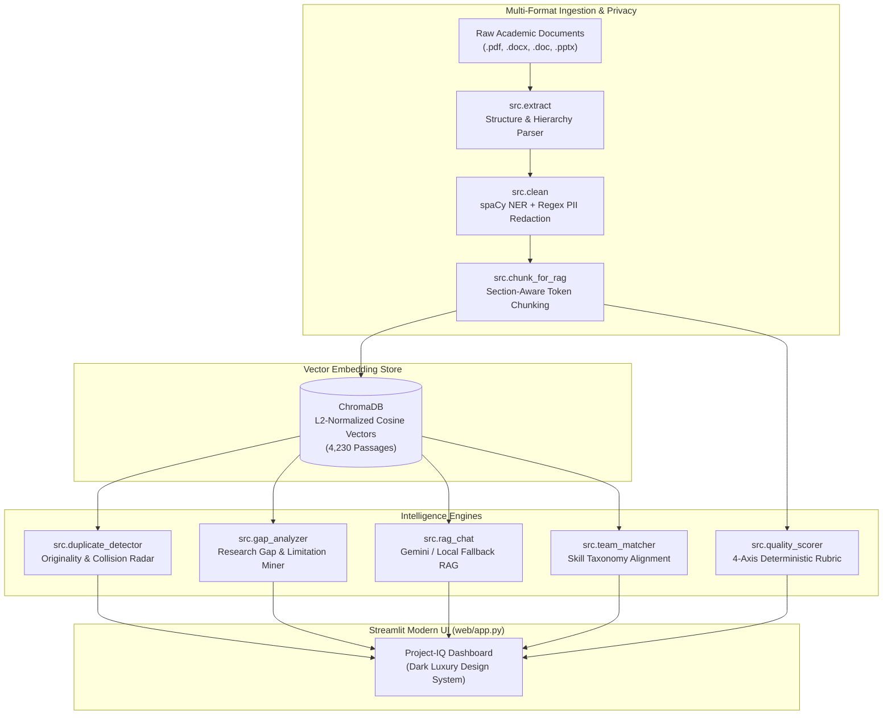

<div align="center">
  
  <h1>Project-IQ</h1>
  <p><strong>Autonomous Academic Intelligence & Structure-Aware RAG Platform</strong></p>
  <p><i>Institutional Capstone Archive Mining • Plagiarism & Collision Auditing • Limitation Synthesis • 4-Axis Rubric Quality Scoring • Citation-Grounded Local RAG</i></p>

  <p>
    <a href="https://www.python.org/"></a>
    <a href="https://streamlit.io/"></a>
    <a href="https://www.trychroma.com/"></a>
    <a href="https://ai.google.dev/"></a>
    <a href="LICENSE"></a>
    <a href="https://github.com/mrcoder5252/PROJECT-IQV2"></a>
  </p>

  <p>
    <a href="#-quick-start"><b>Quick Start</b></a> •
    <a href="#-platform-intelligence-modules"><b>Core Modules</b></a> •
    <a href="#-system-architecture"><b>Architecture</b></a> •
    <a href="#-corpus-telemetry--benchmark"><b>Telemetry</b></a> •
    <a href="#-docker-deployment"><b>Docker</b></a> •
    <a href="#-privacy--compliance"><b>Privacy & Security</b></a>
  </p>
</div>

---

## 🌟 Executive Overview

**Project-IQ** is an institutional academic intelligence platform engineered to mine multi-department archives of final-year engineering capstones, black book project reports, seminar documents, and review presentations (`.pdf`, `.docx`, `.doc`, `.pptx`).

It provides automated originality & semantic collision auditing, research gap synthesis, deterministic rubric-based scoring, cross-disciplinary faculty/team matching, and section-grounded Retrieval-Augmented Generation (RAG) with local offline fallbacks.

---

## 📊 Corpus Telemetry & Benchmark

The platform runs against an institutional engineering corpus with verified end-to-end metrics:

| Metric | Measured Value | Description |
|---|:---:|---|
| **Indexed Passages** | **`4,230`** | L2-normalized cosine vector embeddings in ChromaDB |
| **Raw Documents Mined** | **`250`** | Departmental submissions across Computer Science & Data Science |
| **Sanitized Clean Documents** | **`242`** | Academic text stripped of front-matter and non-scholarly filler |
| **PII Entities Redacted** | **`3,285`** | Deterministic masking of names, roll numbers, emails, and phones |
| **Token Size Compliance** | **`<= 520`** | Strict token boundary ceiling per passage with 80-token overlap |
| **Test Suite Pass Rate** | **`100%`** | 13 automated offline end-to-end and regression test suites |

---

## 🚀 Quick Start

### Windows (One-Click Setup)

1. **Clone the repository:**
   ```cmd
   git clone https://github.com/mrcoder5252/PROJECT-IQV2.git
   cd PROJECT-IQV2
   ```

2. **One-Time Environment Initialization:**
   ```cmd
   setup_windows.bat
   ```
   *Creates `.venv`, installs requirements, downloads the `en_core_web_sm` spaCy model, and generates `.env`.*

3. **Configure Environment:**
   Edit `.env` to configure your admin passkey and optional Gemini API key:
   ```dotenv
   PROJECTIQ_ADMIN_PASSKEY=YourAdminPasskey
   GEMINI_API_KEY=AIzaSy...   # Optional (offline local fallback enabled if omitted)
   ```

4. **Launch Application:**
   ```cmd
   run_all.bat
   ```
   *The interactive dashboard will automatically open at `http://localhost:8501`.*

---

### Linux & macOS

1. **Clone and create a virtual environment:**
   ```bash
   git clone https://github.com/mrcoder5252/PROJECT-IQV2.git
   cd PROJECT-IQV2
   python3 -m venv .venv
   source .venv/bin/activate
   ```

2. **Install dependencies and spaCy language model:**
   ```bash
   pip install --upgrade pip
   pip install -r requirements.txt -r requirements-dev.txt
   python -m spacy download en_core_web_sm
   ```

3. **Configure Environment & Run Diagnostics:**
   ```bash
   cp .env.example .env
   python scripts/doctor.py
   ```

4. **Start Streamlit Dashboard:**
   ```bash
   streamlit run web/app.py
   ```

---

### 🐳 Docker Deployment

Run the complete platform inside a self-contained container:

```bash
# Build and run with Docker Compose
docker compose up --build -d

# Check live logs
docker compose logs -f

# Access the web interface at:
# http://localhost:8501
```

---

## 🧩 Platform Intelligence Modules

Project-IQ features a modular per-theme identity with motion design:

### 1. AI Project Advisor & Novel Ideator (`Module 01`)
- **Conversational RAG**: Grounded directly in indexed project passages across CS and DS cohorts.
- **Citation Cards**: Every response quotes exact document sources, departments, group IDs, and passage similarity scores.
- **Novel Ideator**: Generates tailored project proposals targeting unaddressed departmental research gaps.

### 2. Originality & Duplicate Guard (`Module 02`)
- **Semantic Radar**: Embeds prospective titles and abstracts, searching all indexed historical reports.
- **Dedicated 0–100 Orange Meter**: Custom Plotly gauge displaying originality percentages (`0.0% – 100.0%`).
- **Collision Verdicts**: Categorizes proposals into **High Duplicate Risk**, **Moderate Overlap**, or **High Originality**.
- **Differentiation Playbook**: Generates actionable architectural pivots to maximize novelty before project submission.

### 3. Research Gap Finder (`Module 03`)
- **Limitation Mining**: Parses methodology bottlenecks, computational limits, and future scope items from past reports.
- **Interactive Visualizations**: Frequency distribution charts of frequent technical bottlenecks.
- **AI Proposal Synthesis**: Proposes practical project ideas with estimated feasibility and impact.

### 4. Project Quality Scorer (`Module 04`)
- **Deterministic 4-Axis Rubric**: 100-point transparent academic rubric:
  - **Methodology Depth** (Pipeline rigor, flow, and reproducibility)
  - **Metric Rigor** (Benchmark reporting, empirical validation)
  - **Tech Stack Coherence** (Compatibility and framework relevance)
  - **Problem Clarity** (Objective formulation and boundary definition)
- **Anti-Stuffing Defense**: Penalizes empty buzzword inflation and rewards verified empirical metrics.

### 5. Student Team Skill Matcher (`Module 05`)
- **Engineering Taxonomy Alignment**: Matches student competencies across Vision, NLP, IoT, Blockchain, Cloud, and Healthcare AI.
- **Role Optimization**: Identifies missing capabilities and suggests complementary team members and faculty mentors.

### 6. Institutional Admin Center (`Vault`)
- **Multi-Format Ingestion**: Stage `.pdf`, `.pptx`, `.docx`, and `.doc` files into departmental hierarchy (`CS_1`, `CS_2`, `DS_1`, `DS_2`).
- **Privacy Audit Log**: Real-time breakdown of redacted names, phone numbers, PRNs, and emails.
- **Corpus Telemetry**: Interactive Plotly visualizations (departmental distribution, token size compliance histograms, section rankings).
- **Passage Archive Search**: Deep semantic search across the entire institutional repository.

---

## 🏗️ System Architecture



---

## 📂 Project Directory Structure

```text
PROJECT-IQV2/
├── .streamlit/
│   └── config.toml             # Dark luxury theme & server settings
├── data/
│   ├── raw/                    # Staged multi-format student files (.gitkeep)
│   ├── extracted/              # Structural JSON files with document hierarchy
│   ├── cleaned/                # Sanitized, PII-redacted text documents
│   ├── chunks/
│   │   └── chunks.jsonl        # 4,612 tokenized passages with metadata
│   ├── chroma_db/              # Persistent ChromaDB cosine index (4,230 passages)
│   └── reports/                # Pipeline cleaning & telemetry JSON reports
├── logs/                       # Structured rotating application logs
├── scripts/
│   └── doctor.py               # Pre-flight environment diagnostic tool
├── src/
│   ├── chunk_for_rag.py        # Token-bounded chunker with near-dup detection
│   ├── clean.py                # spaCy NER + regex PII sanitizer
│   ├── config.py               # Centralized configuration with env fallbacks
│   ├── duplicate_detector.py   # Embedding cosine similarity originality engine
│   ├── embeddings.py           # Thread-safe SentenceTransformer embedding cache
│   ├── extract.py              # Multi-format document parser (PDF/DOCX/PPTX/DOC)
│   ├── gap_analyzer.py         # Limitation miner & proposal synthesizer
│   ├── llm.py                  # Resilient Gemini API client with model fallback
│   ├── logger.py               # Structured console & file logging
│   ├── quality_scorer.py       # Deterministic 4-axis 100-point rubric scorer
│   ├── rag_chat.py             # Context-grounded RAG query handler with guardrails
│   ├── team_matcher.py         # Domain taxonomy & faculty mentor recommender
│   └── vector_store.py         # ChromaDB persistence, cosine query, and pruning
├── tests/
│   ├── conftest.py             # Deterministic offline mock fixtures
│   ├── test_e2e_offline.py     # End-to-end pipeline verification test
│   └── test_regressions.py     # 13 regression test suites for edge cases
├── web/
│   ├── assets/                 # Vector SVG emblems (logo, ai, user)
│   └── app.py                  # Streamlit application with motion design
├── Dockerfile                  # Production container definition
├── docker-compose.yml          # Containerized deployment orchestration
├── pyproject.toml              # Build specifications & package metadata
├── requirements.txt            # Core production dependencies
├── run_all.bat                 # Windows automated pipeline runner + web launcher
├── run_pipeline.py             # CLI pipeline orchestrator with stage flags
└── setup_windows.bat           # One-click Windows virtualenv setup
```

---

## ⚙️ Environment Configuration

Configuration variables can be defined in `.env` or system environment variables:

| Variable | Default | Description |
|---|:---:|---|
| `GEMINI_API_KEY` | *(None)* | Google Gemini API key. If omitted, local rule-based synthesis is used. |
| `PROJECTIQ_ADMIN_PASSKEY` | *(None)* | Administrative passkey required to unlock the Admin Center. |
| `PROJECTIQ_EMBEDDING_MODEL` | `all-MiniLM-L6-v2` | SentenceTransformer model used for vector embeddings. |
| `PROJECTIQ_LLM_MODEL` | `gemini-2.5-flash` | Preferred Gemini model. Falls back gracefully if unavailable. |
| `PROJECTIQ_LOG_LEVEL` | `INFO` | Console and file logging verbosity (`DEBUG`, `INFO`, `WARNING`, `ERROR`). |
| `PROJECTIQ_CHUNK_SIZE` | `450` | Target token size per chunk for RAG indexing. |
| `PROJECTIQ_CHUNK_OVERLAP` | `80` | Overlapping token window between adjacent chunks. |
| `PROJECTIQ_HARD_MAX_TOKENS` | `520` | Strict token ceiling per chunk to fit within embedding context limits. |
| `PROJECTIQ_DUPLICATE_THRESHOLD`| `0.82` | Cosine similarity threshold for flagging high duplicate risk. |
| `PROJECTIQ_MODERATE_THRESHOLD` | `0.65` | Cosine similarity threshold for flagging moderate overlap. |
| `PROJECTIQ_MIN_RELEVANCE` | `0.20` | Minimum cosine relevance score required for RAG document retrieval. |
| `STREAMLIT_SERVER_PORT` | `8501` | Port on which the Streamlit web dashboard serves traffic. |

---

## 🔒 Privacy, Compliance & Redaction

Institutional final-year projects often contain sensitive student and faculty information. Project-IQ is built from the ground up to uphold academic data privacy:

- **Automatic Name Redaction**: Removes detected personal names using spaCy Named Entity Recognition combined with context heuristics.
- **Contact & Roll Redaction**: Automatically masks student phone numbers, email addresses, and institutional PRN numbers with deterministic tags (`[NAME]`, `[STUDENT_ID]`, `[PHONE]`, `[EMAIL]`).
- **Scholarly Citation Preservation**: Reference entries (e.g., `[1]`, `[2]`, `Vaswani et al.`) are preserved intact for accurate RAG synthesis.
- **Air-Gapped & Offline Ready**: Runs fully on-premises when Gemini API keys are omitted, ensuring zero institutional research data leaves the campus network.

---

## 🧪 Testing & Quality Assurance

Project-IQ includes an offline testing suite that runs without live external API connections:

```bash
# Execute full test suite
pytest -v
```

### Coverage Highlights:
- **`tests/test_e2e_offline.py`**: Verifies the end-to-end lifecycle: document generation -> extraction -> PII cleaning -> chunking -> vector indexing -> originality detection -> gap analysis -> RAG chat.
- **`tests/test_regressions.py`**: Validates edge cases including hierarchy parsing, PII redactions, decimal series protection, metric-stuffing defenses, and environment variable fallbacks.

All 13 test suites pass reliably in seconds.

---

## 📄 License

Distributed under the **Apache 2.0 License**. See [`LICENSE`](LICENSE) for full details.

<div align="center">
  <sub>Built with ❤️ by <a href="https://github.com/mrcoder5252">mrcoder5252</a> for academic research excellence and capstone innovation.</sub>
</div>
